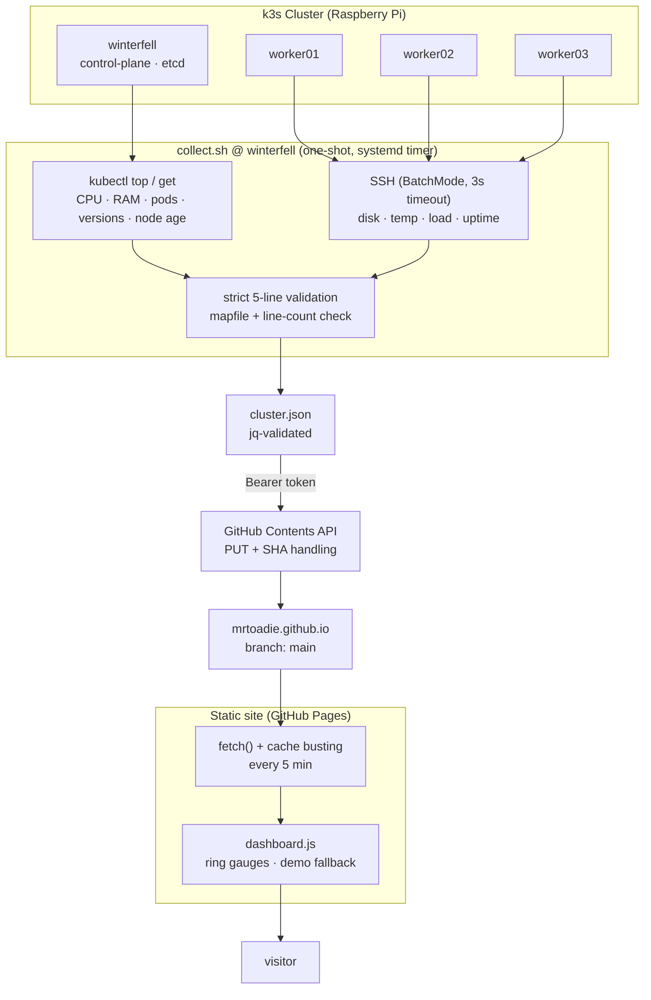
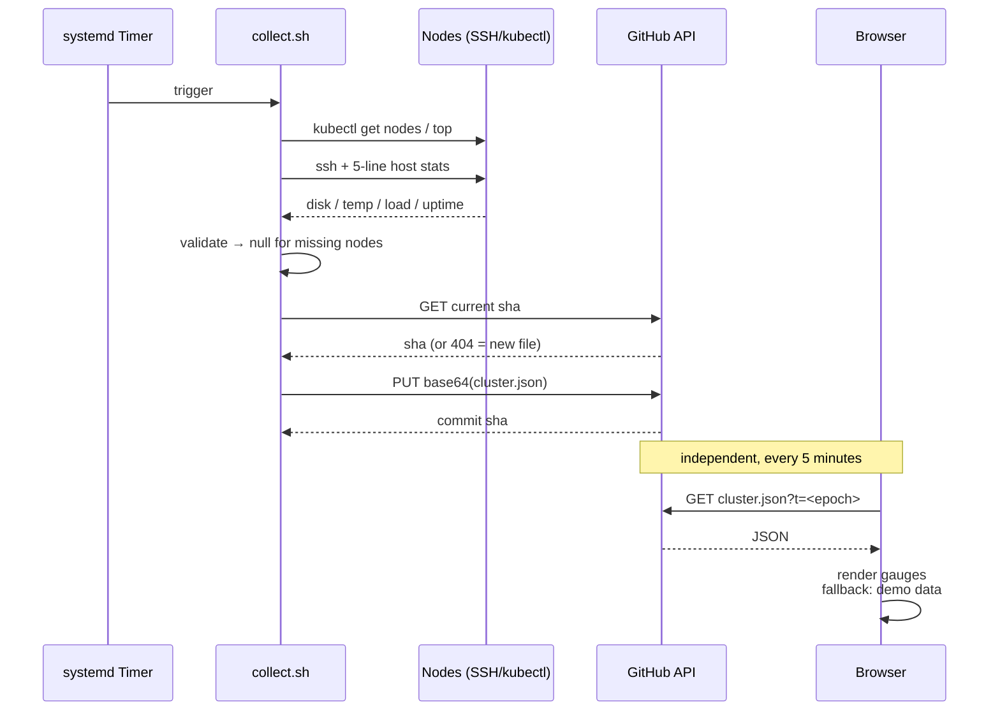

# cluster-metrics-pipeline

**End-to-end observability for a k3s homelab — from scheduler to static website, with no server in the backend.**

A lightweight pipeline that collects metrics from a Raspberry Pi Kubernetes cluster and publishes them as a static page on GitHub Pages. No metrics-server streaming, no database, no running costs — just Bash, jq, kubectl, SSH and the GitHub Contents API.

**→ Live dashboard: <https://mrtoadie.github.io>** · **→ Site README: <https://github.com/mrtoadie/mrtoadie.github.io>**


---

## Architecture





> **Interval ownership:** `collect.sh` itself is interval-agnostic — it does one run and exits. The schedule lives entirely in the systemd timer (`collect.timer`), which currently triggers every **5 minutes**. The **watcher** is a separate device (a Pi Zero 2W _outside_ the cluster) that checks API-server reachability every **15 minutes** and pushes its own heartbeat (`data/watcher.json`). Three different clocks, all deliberate — don't mix them up.
>
> **Failure attribution:** If the collector cannot reach the Kubernetes API, `collect.sh` itself writes a `collector_error` entry with the reason into the feed. The watcher adds the _external_ view, so the dashboard can distinguish "cluster down" from "collector down".

## Why this design?

| Decision                                                 | Reasoning                                                                                                                                                                                                                                                                 |
| -------------------------------------------------------- | ------------------------------------------------------------------------------------------------------------------------------------------------------------------------------------------------------------------------------------------------------------------------- |
| **Snapshot pull by the collector instead of agent push** | The collector actively pulls state — when the cluster dies I want to _see_ that, not a frozen last data point. The watcher notices because it sits outside the cluster.                                                                                                   |
| **GitHub Pages as the data sink**                        | Free, versioned, historically traceable through the commit history of `cluster.json`. Every metrics snapshot is a Git commit.                                                                                                                                             |
| **SSH instead of Node-Exporter for host metrics**        | Read `/proc`, `/sys` and `df` directly — no agent needed on the workers, the 1-GB Pis appreciate it.                                                                                                                                                                      |
| **Demo fallback in the frontend**                        | If `cluster.json` fails to load (offline, fetch error), the page shows clearly labelled demo data instead of an empty page.                                                                                                                                               |
| **Fail-safe per node, not per run**                      | Any single node may fail — SSH timeout, sensor gone, whole node down. Every value passes through its own validator (`is_int` / `is_num`) and becomes `null` individually; the run never aborts. The local host is queried directly, unreachable nodes are simply skipped. |

## The hard way: lessons learned

This pipeline earned its production status through three production bugs:

1. **Row misalignment** — An awk filter that never matched made `df` output silently disappear. Result: the temperature landed in the `disk_percent` field (3,936,024% disk!). Fix: a strict **5-line contract** per node — rootfs %, USB-SSD %, temperature, load, uptime — enforced by a line-count check via `mapfile`.
2. **Inverted media query** — `@media (min-width: …)` instead of `max-width` gave desktop the phone layout and vice versa. A classic, but it only became visible on a smartphone.
3. **Wrong script deployed** — Locally the fixed version ran (`c.sh`), while the control-plane node kept running the old `collect.sh`. GitHub saw different data than the local dry run. Since then: the deploy test runs _on_ the node, not next to it — which is exactly what `--dry-run` is for: collect only, write `/tmp/cluster.json`, no upload.

The honest long-form versions of such incidents — including etcd on SD cards, node rejoin failures and friends — live in the site's incident log: <https://mrtoadie.github.io/incidents.html>.

## Data contract

`data/cluster.json` — a minimal, stable contract:

```json
{
  "timestamp": "2026-10-28T17:20:12Z",
  "collected_on": "winterfell",
  "nodes": [
    {
      "name": "winterfell",
      "role": "control-plane",
      "status": "True",
      "version": "v1.36.3+k3s1",
      "age": "125d"
    }
  ],
  "resource_usage": {
    "winterfell": {
      "cpu_percent": 18,
      "cpu_millicores": 250,
      "mem_percent": 42,
      "mem_mib": 3304,
      "disk_percent": 39,
      "disk_usb": 43,
      "temp_c": 36.5,
      "load1": 1.97,
      "uptime_s": 52546,
      "pods": 25
    }
  },
  "pods": { "total": 46, "running": 46, "pending": 0 },
  "namespaces": 12,
  "deployments": 18,
  "services": 9,
  "source": "winterfell-k3s-cluster"
}
```

The payload is richer than the dashboard needs on purpose: `age` feeds the hardware table on the site, `cpu_millicores` and `mem_mib` preserve the raw `kubectl top` values, `services` is collected for completeness. The frontend is deliberately tolerant: unknown or missing fields become `null` → the gauge shows `–` instead of crashing. `disk_usb` is optional (the USB SSD only exists on the control-plane node); if absent, the frontend falls back to `disk_percent` (rootfs).

## Setup

```bash
# Requirements on the control-plane node
kubectl, jq, curl, base64, ssh (BatchMode + key auth to all workers), bash >= 4

# GitHub token with contents:write for the Pages repo
echo "ghp_…" > ~/.github_token

# One-off test (collect only, write /tmp/cluster.json, no upload)
./collect.sh --dry-run

# Run as a systemd timer
cp systemd/collect.service systemd/collect.timer /etc/systemd/system/
systemctl enable --now collect.timer
systemctl list-timers collect.timer   # verify the interval
```

## Numbers

- **Payload per run:** < 2 KB
- **Intervals:** 5 min (collection timer) / 5 min (frontend refresh) / 15 min (watcher reachability check)
- **Runtime footprint:** one Bash process, 4 SSH sessions à ~200 ms (3s connect timeout each)
- **Cost:** €0/month

## License

MIT
